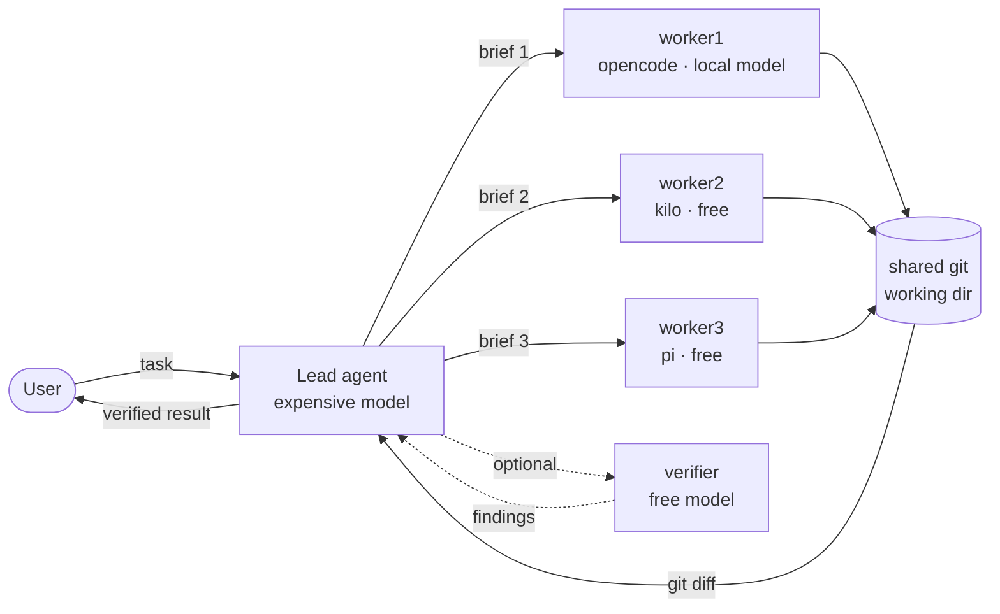

# herdr-multiagent

**Turn one expensive agent into a team of free ones.**

A skill that makes your top-tier coding agent the *lead* of a small fleet of free
and small-model workers running in [Herdr](https://herdr.dev) panes — fan out the
typing, keep your tokens for the thinking, and review the diff, not the
transcript.

<p>
  
  
  
</p>

---

## The problem

Frontier-model tokens are the scarce resource. Most of the work an agent does —
scaffolding, boilerplate, mechanical refactors across dozens of files, test
stubs, docstrings, repetitive edits — does not need a frontier model. Paying
frontier prices to type it is waste.

But delegating naively is worse: free models are meaningfully weaker, and a task
you have to rewrite costs more than one you never delegated. The hard part is not
*having* workers — it is **briefing them well, running them in parallel, and
verifying their output cheaply**.

`herdr-multiagent` is that discipline, packaged as a skill.

## What it does

- **Gates on Herdr** — refuses to run outside a Herdr pane, so it never tries to
  drive a session it cannot see.
- **Surveys the fleet** — discovers which free agent kinds (`pi`, `opencode`,
  `kilo`, `hermes`, …) are installed and which local/small models are reachable.
- **Fans out** — splits sibling panes, starts workers in each, submits every
  brief before waiting so the free models run concurrently.
- **Briefs like a senior engineer** — exact file paths, concrete acceptance
  criteria, pre-made decisions, and an explicit *do-not-touch* list.
- **Collects cheaply** — verifies via the shared `git diff`, never by pulling a
  full agent transcript back into the lead's context.
- **Fails over** — on a stall or provider error, starts the next free kind and
  hands over context instead of restarting.
- **Stays safe** — leaves the user's focus alone, never auto-answers an
  approval prompt, never closes panes it did not create.

## Architecture



The lead owns the **what** and the **verification**. The workers own the
**characters**. The verifier catches the seams where two weak models' work meets.

## Install

Drop the skill into your agent's skills directory:

```bash
# Claude Code / opencode / compatible agents
git clone https://github.com/RubberDucky3/herdr-multiagent.git \
  ~/.claude/skills/herdr-multiagent
```

On Windows (PowerShell):

```powershell
git clone https://github.com/RubberDucky3/herdr-multiagent.git `
  "$env:USERPROFILE\.claude\skills\herdr-multiagent"
```

That's it — the skill self-registers from its `SKILL.md` frontmatter.

## Requirements

- [Herdr](https://herdr.dev) — the terminal workspace manager for AI agents.
- At least one **free agent CLI installed as a Herdr integration** (`pi`,
  `opencode`, `kilo`, `hermes`, `cline`, …). Check with
  `herdr integration status`.
- The skill only activates inside a Herdr pane (`HERDR_ENV=1`).

## Usage

Just ask your lead agent to delegate, in plain language:

> "Add the same retry wrapper to these 6 files — delegate the typing,
> keep the design."

Or invoke it directly:

> `/herdr-multiagent scaffold the test stubs for every module under src/`

The skill walks the lead through survey → brief → fan out → collect → verify.

### A worked run

```
1. Survey   herdr agent list          → opencode, kilo, pi available and free
2. Judge    mechanical + verifiable   → delegate; 3 workers × 2 files
3. Split    3 sibling panes (--no-focus), read each pane_id from JSON
4. Start    worker1=opencode · worker2=kilo · worker3=pi (local models)
5. Brief    exact paths, verbatim signature, "touch nothing else",
            acceptance = cargo test handler_*
6. Submit   all three, then `herdr agent wait` on each (timeout 600000)
7. Verify   git diff → read the 6 hunks → fix the one file a worker missed
8. Report   what changed, who did what, what was re-run and its output
```

## When to use it — and when not to

**Use it** when the task is specifiable in a paragraph and verifiable by reading
the result: scaffolding, boilerplate, mechanical refactors, test stubs,
docstrings, config, format conversions, repetitive edits.

**Don't** for architecture, security-sensitive code, subtle debugging, or tricky
concurrency — anything where a plausible-looking wrong answer is expensive. Split
half-judgment tasks: *you* decide, the worker types.

## Token discipline

The whole point is that your context stays small.

- Never paste file contents into a brief when a path will do — the worker reads.
- Never read a full agent log to confirm success; the diff is the signal.
- Batch related edits into one brief, not one worker per file.
- Don't delegate something you could finish in a couple of edits.

## Safety

- Background workers always run with `--no-focus`; your focus stays put.
- Approvals and questions are surfaced to the user — never auto-answered.
- Panes, tabs, and workspaces the skill did not create are left untouched.
- All commands are Herdr's documented, JSON-returning CLI surface.

## Contributing

Issues and PRs welcome. If you adapt the brief-writing guidance or add support
for another free agent kind, send it upstream — the whole value is in the
briefing discipline, so improvements there help everyone.

## License

[MIT](LICENSE)
